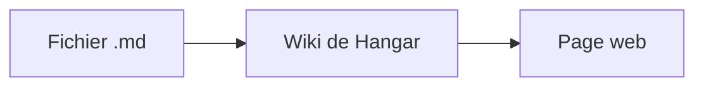

Cette page montre la syntaxe Obsidian reconnue par le wiki. ^intro

## Liens internes

- Lien simple : [[Accueil]]
- Lien avec texte : [[Accueil|voir la page d'accueil]]
- Lien vers un titre : [[Accueil#Pour commencer]]
- Lien vers un titre de cette page : [[#Intégrations]]
- Lien vers un bloc : [[#^intro]]
- Lien par alias : [[Aide]] pointe ici
- Lien Markdown classique : [la page d'accueil](../Accueil.md)
- Page inexistante : [[Page à créer]]

## Intégrations

Une image, redimensionnée à 120 px :

![[hangar-logo.svg|120]]

Une section d'une autre note :

![[Accueil#Pour commencer]]

## Callouts

> [!note]
> Un callout simple, avec du **Markdown** et un lien [[Accueil]].

> [!warning] Attention
> Titre personnalisé.

> [!question]- Callout replié (cliquez)
> Contenu caché par défaut.

> [!example]+ Callouts imbriqués
> > [!success] Réussi
> > Un callout dans un callout.

## Mise en forme

==Texte surligné==, ~~texte barré~~, **gras**, *italique*, `code`.

Un commentaire invisible : %%ce texte n'apparaît pas%% (voir le fichier source).

Tags en ligne : #guide #wiki/documentation

### Tâches
- [x] Lire les fichiers `.md`
- [x] Afficher les liens `[[...]]`
- [ ] Écrire la documentation du projet

### Tableau
| Syntaxe | Rendu |
| --- | --- |
| `[[Page]]` | lien interne |
| `![[image.png]]` | image intégrée |
| `#tag` | tag cliquable |

### Formules
En ligne : $e^{i\pi} + 1 = 0$

$$
\int_0^1 x^2 \, dx = \frac{1}{3}
$$

### Code et diagrammes
```python
def bonjour(nom):
    return f"Bonjour {nom} #pas-un-tag [[pas un lien]]"
```



### Note de bas de page
Une affirmation sourcée[^1].

[^1]: La source en question.
